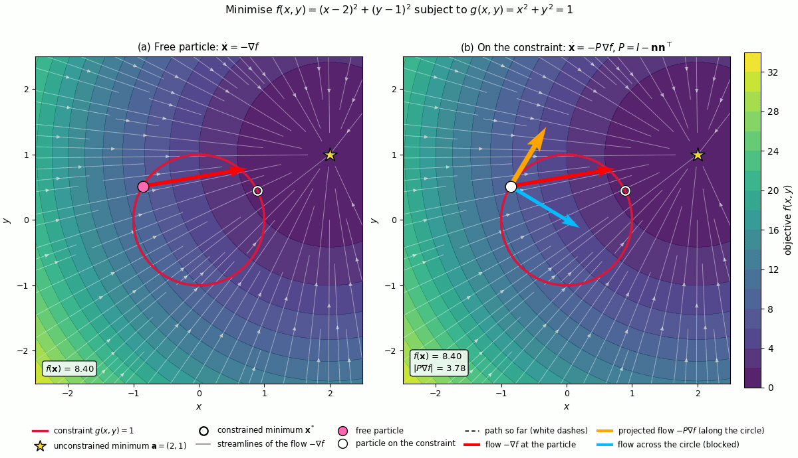
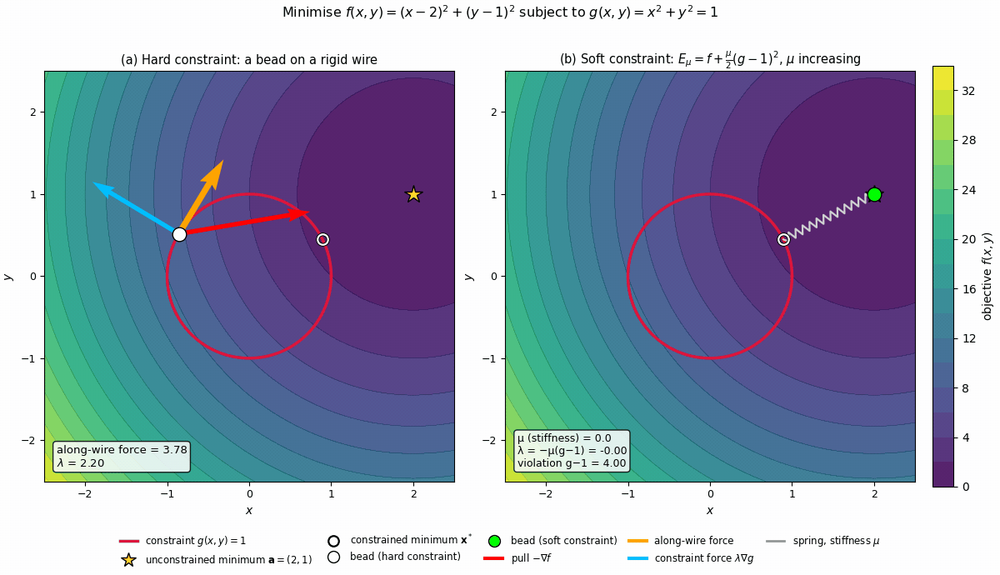
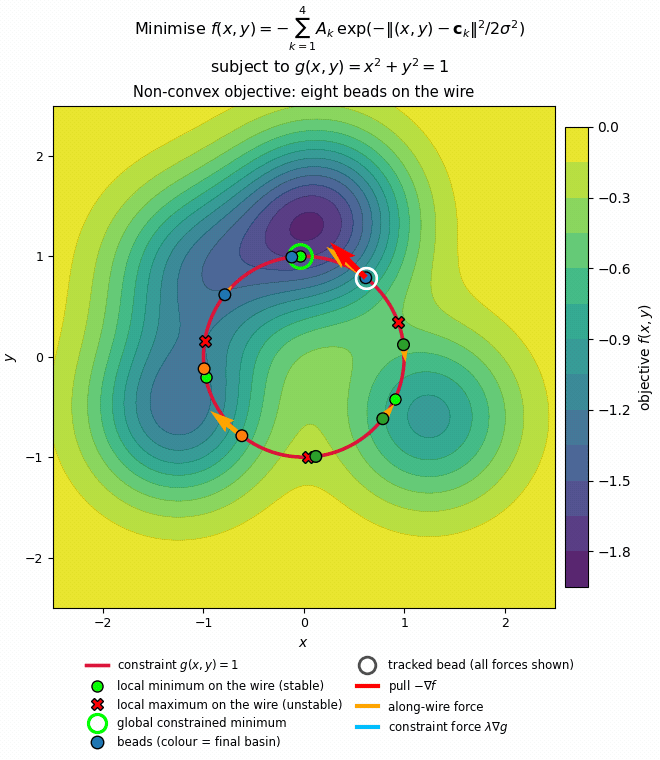

Almost every decision is an optimisation. A business wants the highest profit,
the lowest cost or the fastest delivery, and a person wants the most out of a day
or a salary. The best answer on paper is usually out of reach, because real
choices come with limits: a budget, a deadline, a factory that makes only so
many units. These constraints shrink the set of options we can explore. So the
real question is how to find the best option that stays inside the limits.

A first course in calculus answers the case without limits. A minimum, or a
maximum, sits where the derivative is zero, with a check on the second
derivative. Physics gives the same answer as a picture. A marble in a bowl rolls
to the bottom and stays there, because at the bottom the net force on it is zero.
Rain water collects in a dip in the ground for the same reason. A minimum is a
place where the net force vanishes.

The same logic extends to optimisation with limits. Thread the marble onto a curved
wire that passes over the bowl, like a bead on a necklace. It still wants to roll downhill, and it
can only slide along the wire, so it comes to rest somewhere on the wire, usually
short of the bottom. That resting spot is the answer to the constrained problem,
and the method of Lagrange multipliers is the rule that finds it (Figure 1).

<figure style="text-align:center;margin:1.5em 0">
<video autoplay loop muted playsinline preload="metadata" style="max-width:100%;height:auto" aria-label="A marble rolling to the bottom of a bowl, next to a bead on a curved wire over the same bowl stopping at the wire's lowest point"><source src="bowl-3d.mp4" type="video/mp4"></video>
<figcaption style="font-size:0.9em;opacity:0.75;margin-top:0.5em;text-align:left"><strong>Figure 1.</strong> The bowl <em>z</em> = <em>f</em>(<em>x</em>,<em>y</em>) = (<em>x</em>−2)² + (<em>y</em>−1)². <strong>(a)</strong> Without a constraint, a free marble (pink) rolls downhill to the bottom of the bowl at <strong>a</strong> = (2,1), where <em>f</em> = 0. <strong>(b)</strong> With the constraint <em>x</em>² + <em>y</em>² = 1, the circle lifted onto the bowl becomes a curved wire (red). The bead (white) starts at the same point and slides along the wire to its lowest point <strong>x</strong>* ≈ (0.894, 0.447), where <em>f</em> ≈ 1.53, short of the bottom.</figcaption>
</figure>

In symbols, to solve

$$\min_{x,y}\; f(x,y)\quad\text{subject to}\quad g(x,y)=c,$$

you add a number $\lambda$ and solve

$$\nabla f=\lambda\,\nabla g,\qquad g=c.$$

Most of us learn this recipe long before anyone explains why the two gradients
end up parallel. The recipe says that two forces cancel, and to see why we need
two ideas from mechanics, force and energy.

Think of the objective $f$ as a **potential energy**. It pulls with a force

$$\mathbf F = -\nabla f,$$

which points downhill, toward smaller $f$.

Think of the constraint $g(x,y)=c$ as a **rigid wire** that the bead must stay
on. The gradient $\nabla g$ points straight across the wire, because a gradient is
always perpendicular to its own level curve.

Now put a bead on the wire. It feels the full pull $\mathbf F$, and it can only
slide along the wire. Split the pull into two parts:

- The part **across** the wire meets the wire itself. The wire pushes back with an
  equal and opposite **reaction force**, and this push always points across the
  wire, along $\nabla g$. Call it $\mathbf N=\lambda\,\nabla g$. The number
  $\lambda$ says how hard the wire pushes, and its sign says in which direction.
- The part **along** the wire moves the bead. While this part is there, the bead
  keeps sliding.

The bead stops when the along-wire part is zero. At that point the whole pull
points across the wire, so it is parallel to $\nabla g$:

$$\underbrace{-\nabla f}_{\text{pull}}\;+\;\underbrace{\lambda\,\nabla g}_{\text{wire's push}}\;=\;\mathbf 0
\qquad\Longleftrightarrow\qquad \boxed{\;\nabla f=\lambda\,\nabla g\;}.$$

This is the Lagrange condition, found by balancing forces. The multiplier
$\lambda$ is the strength of the wire's push.

The same idea also works as a flow. Picture $-\nabla f$ as a fluid that runs
downhill toward the minima of $f$. A free particle drifts with this flow and ends
in the minimum of the basin where it starts. A particle held on the constraint can
only move along it, so it follows only the part of the flow that runs along the
constraint. With the unit normal $\mathbf n=\nabla g/\lVert\nabla g\rVert$ and the
projection $P=I-\mathbf n\mathbf n^{\top}$ onto the tangent direction, the particle
moves with the projected flow (Figure 2)

$$\dot{\mathbf x}=-P\,\nabla f(\mathbf x).$$

It stops when $P\nabla f=\mathbf 0$, when the flow points straight across the
constraint and has nothing left to push it along. Then $\nabla f$ is parallel to
$\nabla g$, which is again $\nabla f=\lambda\nabla g$. Any further drop in $f$
would need the particle to leave the constraint.

<figure style="text-align:center;margin:1.5em 0">

<figcaption style="font-size:0.9em;opacity:0.75;margin-top:0.5em;text-align:left"><strong>Figure 2.</strong> Gradient flow for <em>f</em>(<em>x</em>,<em>y</em>) = (<em>x</em>−2)² + (<em>y</em>−1)² with the constraint <em>g</em>(<em>x</em>,<em>y</em>) = <em>x</em>² + <em>y</em>² = 1. White streamlines show the flow −∇<em>f</em>. <strong>(a)</strong> A free particle (pink) follows the flow to the unconstrained minimum <strong>a</strong> = (2,1), where <em>f</em> = 0. <strong>(b)</strong> A particle held on the circle (white) moves with the projected flow −<em>P</em>∇<em>f</em> (orange), the along-circle part of −∇<em>f</em> (red); the part across the circle (blue) is blocked. The particle stops at <strong>x</strong>* ≈ (0.894, 0.447), where the flow points straight across the circle and <em>f</em> ≈ 1.53.</figcaption>
</figure>

You can join the objective and the constraint into one landscape, the
*Lagrangian*

$$\mathcal L(x,y;\lambda)=f(x,y)-\lambda\,\big(g(x,y)-c\big).$$

Its force is $-\nabla f + \lambda\nabla g$, and setting it to zero gives the same
balance.

A rigid wire is an ideal. In computer code we often use a **spring**, which pulls the
bead back toward the constraint and charges energy for every step away from it.
The total energy is

$$E_\mu(x,y)=\underbrace{f(x,y)}_{\text{go downhill}}\;+\;\underbrace{\tfrac{\mu}{2}\big(g(x,y)-c\big)^2}_{\text{cost of leaving } g=c}.$$

The objective pulls the bead toward its own minimum, and the spring pulls it back
onto $g=c$. The stiffness $\mu$ sets the price of leaving. The bead stops where
the two forces cancel:

$$\nabla f + \mu\,(g-c)\,\nabla g = 0
\qquad\Longleftrightarrow\qquad
\nabla f = \underbrace{-\mu\,(g-c)}_{=\;\lambda}\,\nabla g.$$

Two facts follow. First, $\lambda$ is the spring's tension, since
$\lambda=-\mu(g-c)$ is how hard the spring pulls. Second, a soft spring lets the
bead sit a little off the constraint. As $\mu$ grows, this gap shrinks to zero,
while the tension $-\mu(g-c)$ stays finite and approaches the wire's $\lambda$. A rigid
wire is a spring of infinite stiffness.

<figure style="text-align:center;margin:1.5em 0">

<figcaption style="font-size:0.9em;opacity:0.75;margin-top:0.5em;text-align:left"><strong>Figure 3.</strong> Minimising <em>f</em>(<em>x</em>,<em>y</em>) = (<em>x</em>−2)² + (<em>y</em>−1)² on the unit circle <em>g</em>(<em>x</em>,<em>y</em>) = <em>x</em>² + <em>y</em>² = 1. Colours show <em>f</em>; the star is the unconstrained minimum <strong>a</strong> = (2,1) and the ring is the constrained minimum <strong>x</strong>* ≈ (0.894, 0.447). <strong>(a)</strong> Hard constraint: the pull −∇<em>f</em> (red) splits into an along-wire force (orange), which shrinks to zero, and the constraint force λ∇<em>g</em> (blue). <strong>(b)</strong> Soft constraint: a spring of stiffness μ replaces the wire; as μ grows, the bead moves onto the circle and the spring tension −μ(<em>g</em>−1) approaches λ* ≈ −1.24.</figcaption>
</figure>

In Figure 3, the objective is a bowl that pulls toward one point, and the wire
is a circle. The left panel shows the rigid wire, where the orange
along-wire force shrinks to zero while the bead slides. In the right panel, a spring replaces the
wire and gets stiffer. The bead starts where the bowl alone would put it, with the
spring slack, and is pulled onto the circle as the spring tightens. The tension
approaches the same $\lambda$ as the wire's push. This is the **penalty method** of constrained optimisation,
and the starting point of the augmented Lagrangian.

A bowl-shaped (convex) objective has one balanced minimum. Real objectives are
bumpy. Then the balance $\nabla f=\lambda\nabla g$ holds at every valley bottom on the wire, where the bead rests, and at every
ridge top, where
the smallest nudge sends it away. Each point has its own $\lambda$.

In Figure 4, eight beads start on a landscape with several wells. Green dots
mark stable minima and red crosses mark unstable maxima. All of them satisfy
$\nabla f=\lambda\nabla g$. Each bead settles in the well where it starts, so some
end in shallow wells. The ringed bead heads for the deepest valley, and its red
pull and blue push become equal and opposite when it stops.

<figure style="text-align:center;margin:1.5em 0">

<figcaption style="font-size:0.9em;opacity:0.75;margin-top:0.5em;text-align:left"><strong>Figure 4.</strong> A non-convex objective of four Gaussian wells, <em>f</em>(<em>x</em>,<em>y</em>) = −Σ<em>k</em> <em>Ak</em> exp(−‖(<em>x</em>,<em>y</em>)−<strong>c</strong><em>k</em>‖²/2σ²), on the same unit circle. Green dots are local minima on the wire (stable), red crosses are local maxima (unstable), and the green ring is the global constrained minimum; all satisfy ∇<em>f</em> = λ∇<em>g</em>. Eight beads, coloured by the basin where they settle, carry their along-wire force (orange); the tracked bead also shows −∇<em>f</em> (red) and λ∇<em>g</em> (blue).</figcaption>
</figure>

So force balance finds the stationary points, minima and maxima alike. Finding the best minimum is a separate job, as in ordinary gradient descent, and
it needs many starting points, annealing, or a global method.

The table sums up the whole idea.

| idea | in words | in symbols |
|---|---|---|
| objective = potential | it pulls the bead downhill | $\mathbf F=-\nabla f$ |
| constraint = wire | the bead stays on $g=c$; the wire pushes only across itself | $\mathbf N=\lambda\nabla g$ |
| balance | the bead rests when no force acts along the wire | $-\nabla f+\lambda\nabla g=\mathbf 0$ |
| the multiplier | how hard, and which way, the wire pushes | $\lambda$ |
| tangency | at rest, a contour of $f$ just touches the wire | $\nabla f\parallel\nabla g$ |

Minimising $f$ on $g=c$ means letting a bead slide on a wire
until the wire's push cancels the pull. The condition $\nabla f=\lambda\nabla g$
is that balance, and $\lambda$ is how hard the wire pushes.

The multiplier also has a meaning for the business decisions we started with. It
measures how much the best value of $f$ changes when the limit $c$ moves by one
unit, $\lambda = \mathrm{d}f^{*}/\mathrm{d}c$. Economists call it the **shadow price** of the
constraint. A large $|\lambda|$ marks a limit that is worth paying to relax, and a
$\lambda$ near zero marks a limit that barely matters.
